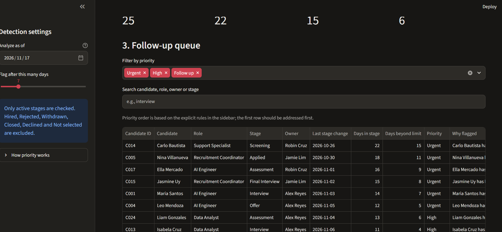

# Hiring Stall Alerter

**A CSV-based hiring pipeline follow-up dashboard, built with ChatGPT-assisted Python and Streamlit.**

The app finds candidates who have stayed in an *active* hiring stage longer than a chosen threshold, orders the follow-up queue by clear rules, explains each flag, and recommends a next step for a recruiter to review. It does **not** make hiring decisions or send messages.



## Demo result

With the included fictional data, **Analyze as of = 2026-11-17** and **threshold = 7 days**, the dashboard produces:

| Metric | Result |
|---|---:|
| Valid candidates | 25 |
| Active candidates | 22 |
| Flagged for follow-up | 15 |
| Urgent follow-ups | 6 |

These values were verified on a Windows PC running **Python 3.13** and Streamlit. The screenshot is from the locally running app; it is not a public deployment.

## Features

- Load a ready-to-use 25-candidate fictional CSV or upload another CSV.
- Select an analysis date and a stall threshold of 1–30 days.
- Exclude closed stages: Hired, Rejected, Withdrawn, Closed, Declined, and Not selected.
- Flag stalled candidates, explain *why*, and rank them Urgent / High / Follow up.
- Provide a stage-specific next action for **human review**.
- Search by candidate, role, owner, or stage; filter by priority.
- Download the displayed follow-up queue as CSV.
- Warn about malformed input, invalid/future dates, and duplicate candidate IDs.

## Quick start: Windows

You need **Python 3.11 or newer** (Python 3.13 was used in the verified local run).

1. Download or clone this repository.
2. Open the project folder.
3. Double-click **`start_windows.bat`**. On first launch, it creates `.venv` and installs the dependencies.
4. Open **http://localhost:8501** if a browser does not open automatically.
5. Keep the Command Prompt window running while using the app.

### Manual start (PowerShell)

From **inside the project directory**:

```powershell
py -m venv .venv
.\.venv\Scripts\python.exe -m pip install -r requirements.txt
.\.venv\Scripts\python.exe -m streamlit run app.py
```

If `py` is unavailable, substitute `python -m venv .venv` in the first command.

## How to test the app

1. Choose **Try example data**.
2. Set the analysis date to `2026-11-17` and the threshold to **7** days.
3. Check the four reference metrics above.
4. Change the threshold to **10**; the stalled count should decrease. Restore it to **7**.
5. Search for `Maria Santos`, clear the search, and try the priority filter.
6. Download the follow-up CSV and open it in Excel.
7. As an extra test, upload a modified sample CSV containing an invalid `last_stage_change` date and check that the app reports a warning.

The first six checks were performed during the project walkthrough; the malformed-input UI example is a suggested follow-up check. Input validation is also covered by the automated tests.

## CSV schema

The file must include these column headers (in any order):

```csv
candidate_id,candidate_name,role,stage,last_stage_change,owner
C001,Alex Torres,Support Specialist,Interview,2026-11-08,Robin Cruz
```

- Dates: `YYYY-MM-DD`.
- Candidate IDs must be unique.
- `candidate_id`, `candidate_name`, `stage`, and `last_stage_change` cannot be blank; `role` and `owner` may be blank.
- Extra columns are ignored. Use CSV UTF-8 when exporting from Excel.

You can use `sample_hiring_board.csv` as your upload template. It contains **fictional data** only.

## How the rules work

```text
CSV data + analysis date + threshold
    ↓
Validate the rows and skip invalid records with warnings
    ↓
Exclude candidates in closed stages
    ↓
Days in stage = analysis date − last stage change
    ↓
Flag candidate if days in stage >= threshold
    ↓
Rank and explain each follow-up
    ↓
Human reviews the result → optional CSV export
```

**Priority rules:**

- **Urgent** — at least **7 days beyond** the threshold, or in Offer/Final Interview at least **3 days beyond** it.
- **High** — at least **3 days beyond** the threshold, or in Offer/Final Interview at the threshold.
- **Follow up** — every other candidate at or beyond the threshold.

Within each priority group, the app orders candidates by days beyond the limit, with hiring-stage precedence used in scoring. Recommendations come from a rule-based lookup by stage, **not from an LLM at runtime**. No email, ATS integration, or external AI API is called.

## Project files

| File | Purpose |
|---|---|
| `app.py` | Streamlit user interface |
| `engine.py` | CSV checks, date calculations, priorities, actions |
| `sample_hiring_board.csv` | Fictional sample hiring board |
| `sample_followup_report.csv` | Reference output for the 2026-11-17 example |
| `tests/test_engine.py` | Automated tests of the core logic |
| `start_windows.bat` | Windows launcher |
| `AI_BUILD_LOG.md` | Actual AI-assisted development and testing record |
| `SUBMISSION_CHECKLIST.md` | Outstanding quest and video submission tasks |
| `WALKTHROUGH.md` | Beginner-friendly local setup |
| `docs/dashboard.png` | Screenshot of the locally verified dashboard |

## Run the automated tests

From inside this project directory:

```powershell
.\.venv\Scripts\python.exe -m unittest discover -s tests -v
```

**14 automated tests passed** in the project workspace, covering CSV validation, dates, threshold boundaries, closed stages, ordering, actions, and export fields. The user separately confirmed three manual UI tests passed: threshold adjustment, search/filter, and export.

## AI-first approach

ChatGPT was used to break down the task, generate the first Python/Streamlit codebase and tests, explain local setup, interpret actual screenshots, and plan validation. **AI assisted development; AI does not decide the runtime results.** This was an intentional shift from visual workflow-building toward a standalone, AI-assisted coded application.

Read [`AI_BUILD_LOG.md`](AI_BUILD_LOG.md) for the verified timeline, evidence, and reflection prompts. Only actual work and outcomes should be described as completed in the quest submission.

## Limitations and safety

- CSV import only; no live applicant-tracking-system integration.
- A stage's inactivity is measured solely from `last_stage_change`.
- No emails are drafted/sent, no ATS records are modified, and no hiring decisions are automated.
- Rules are fixed in code and should be reviewed against each organization's recruiting policy.
- Use invented or authorized candidate records; do not publish private applicant information.

This is an educational prototype for operational follow-up, not a candidate suitability/ranking system.
